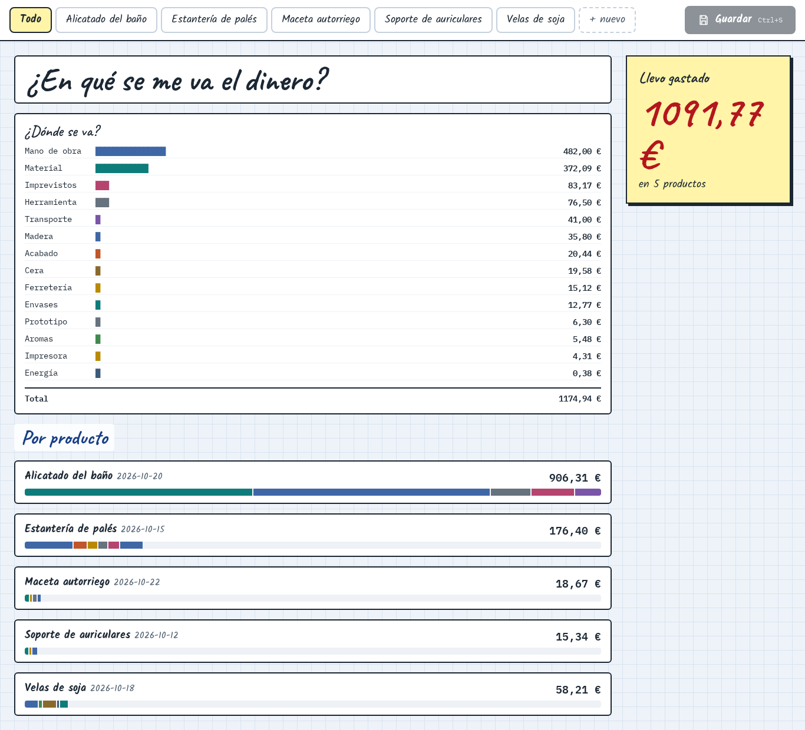
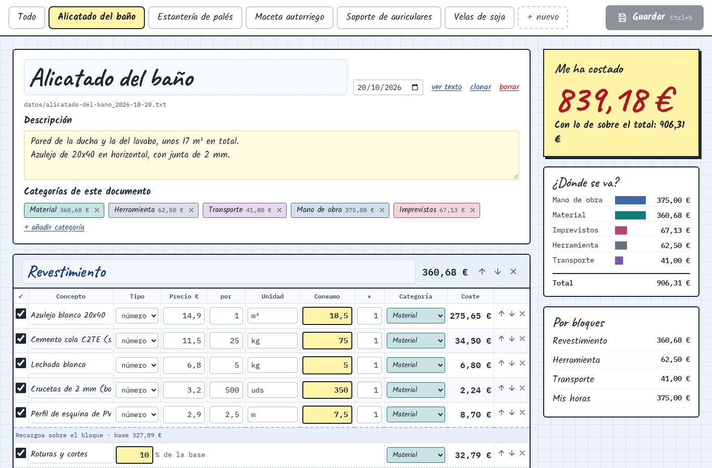
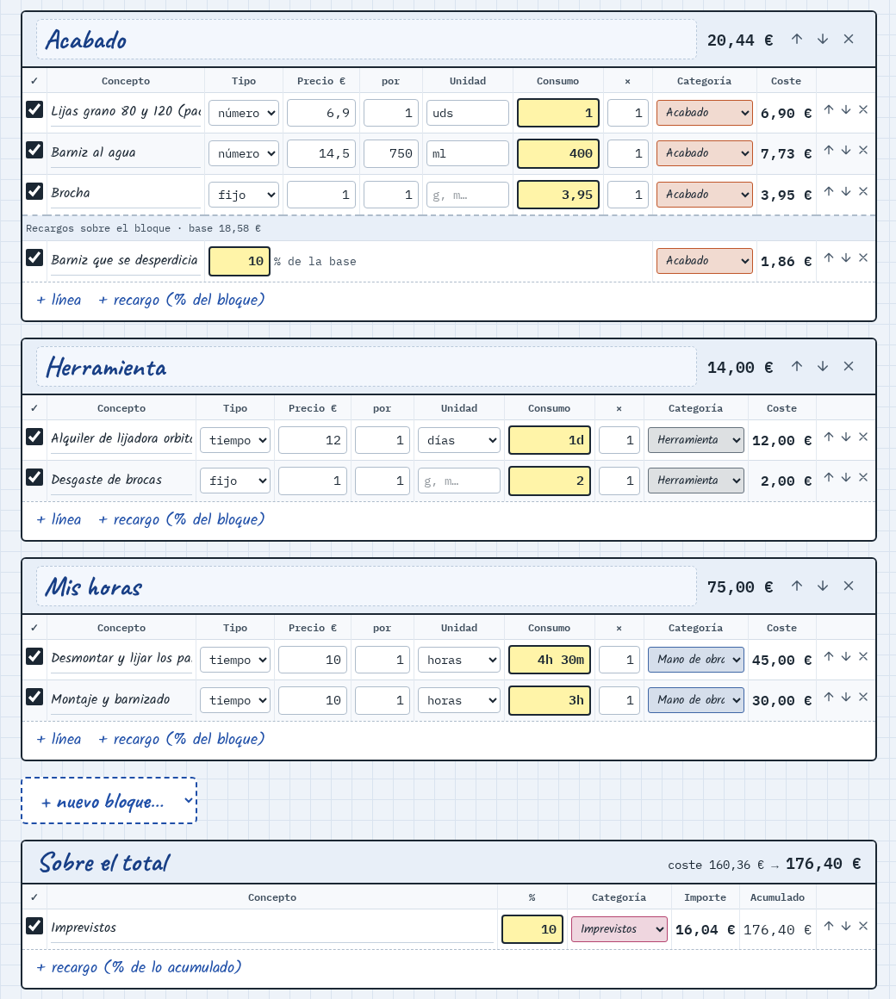
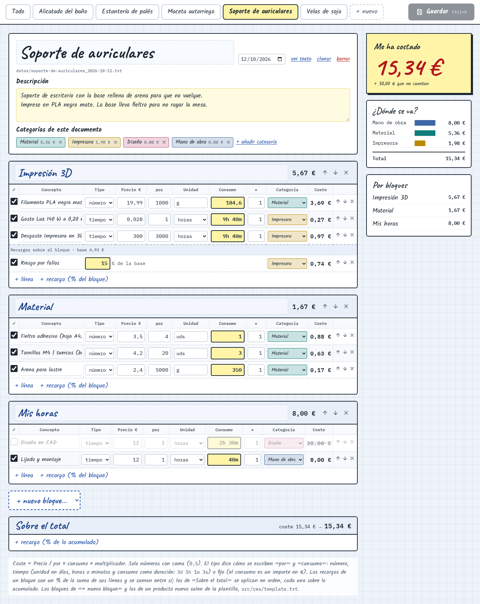
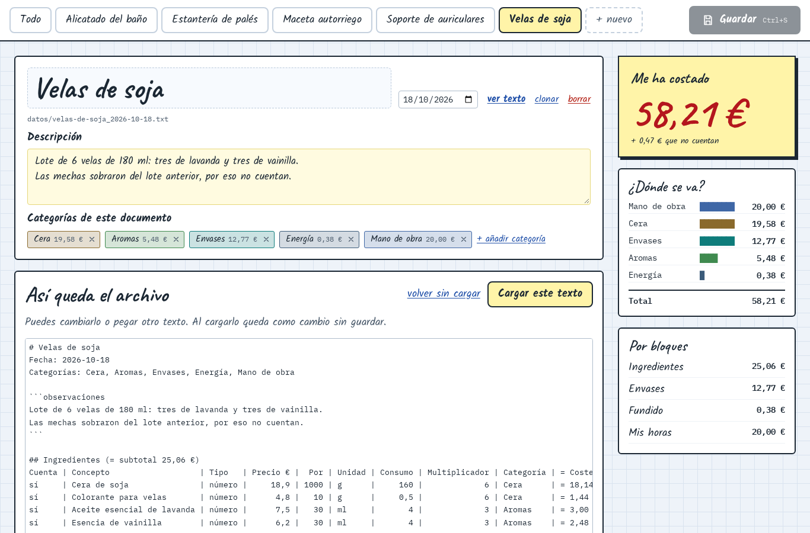
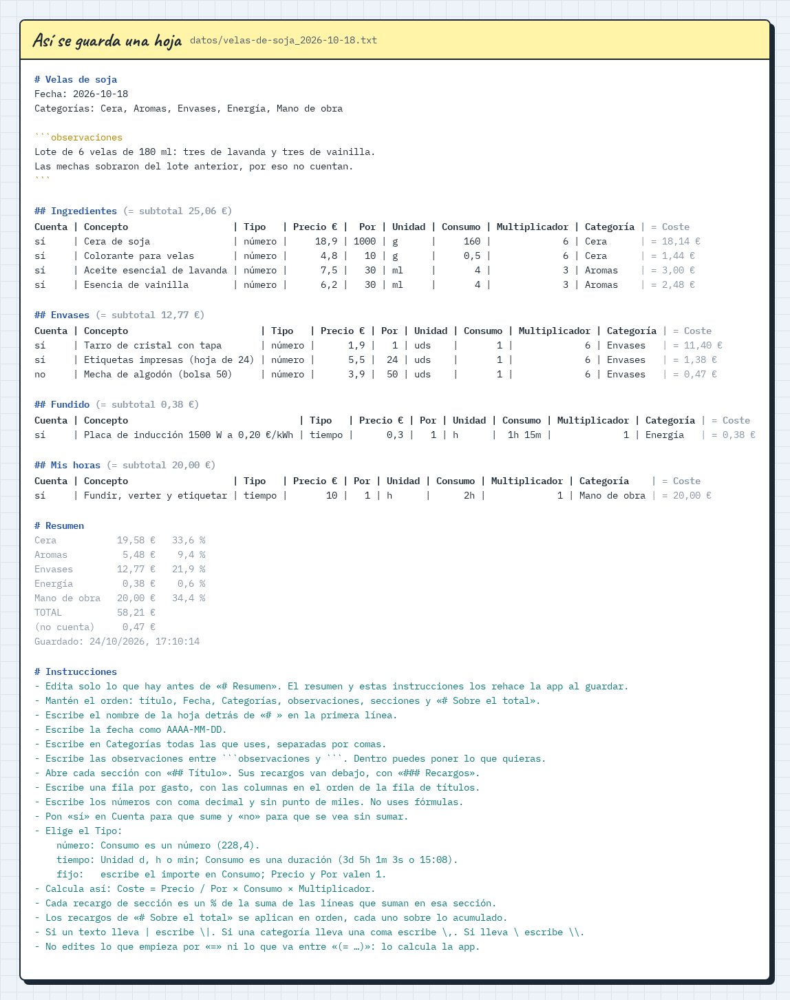
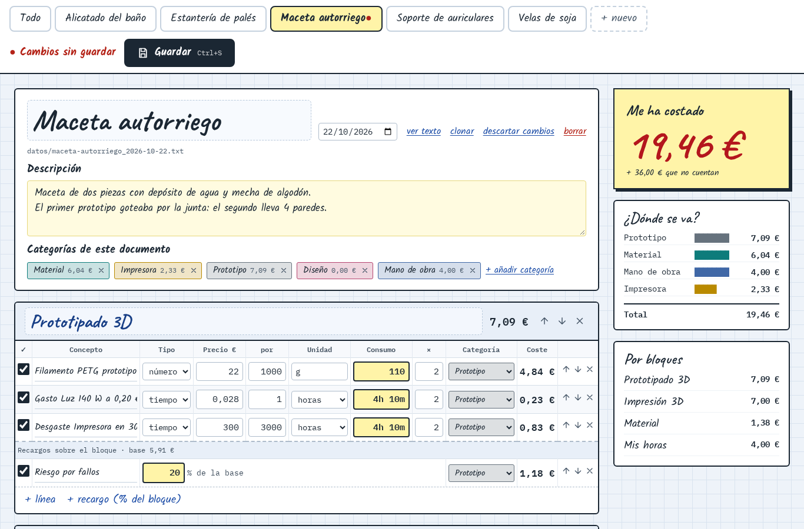

# Cuánto me cuesta

<p align="center">
    
</p>

<p align="center">
    <a href="#qué-es-esto">Qué es esto</a> ·
    <a href="#pensada-para-la-ia">Pensada para la IA</a> ·
    <a href="#funcionalidades">Funcionalidades</a> ·
    <a href="#instalar">Instalar</a> ·
    <a href="#desarrollo">Desarrollo</a> ·
    <a href="#galería">Galería</a>
</p>

## Qué es esto

Una app local para apuntar lo que cuesta cada cosa que hago y ver en qué se va el dinero. Cada producto es una hoja de costes: el filamento, la luz de la impresora, el desgaste, los fallos, mis horas… Cada línea calcula su propio coste, y la app suma, aplica los recargos y el margen, y te enseña por categorías dónde se va el dinero.

Nace de una pregunta sencilla que nunca sabía responder: «¿cuánto me ha costado esto de verdad?». Una hoja de cálculo se quedaba corta o se volvía un lío de fórmulas, así que la app hace las cuentas y yo solo apunto.

Los datos son archivos de texto normales (`.cmctxt`), uno por producto, que guardas donde quieras y se leen y se editan a mano con cualquier editor de texto. No hay base de datos, ni cuentas, ni nada que salga de tu equipo.

Es un proyecto personal, nacido de una necesidad propia y sin capas de más, sobre todo buscando la simplicidad o soluciones sencillas a acciones cotidianas.

## Pensada para la IA

Lo peculiar de esta app es que cada hoja es un texto plano que se explica solo, con sus instrucciones al final, así que es muy amigable con la IA: pegas una hoja en cualquier chat, le pides tu presupuesto y pegas la respuesta en «Ver texto» para verlo todo representado. La IA no se olvida de los detalles, y el repositorio trae skills con el formato (`.claude/skills/`) y está abierto a un asistente dentro de la app que cambie la hoja con un prompt (en un futuro se podría implementar, ahora mismo no urge).

## Funcionalidades

- **Como un editor:** abres, arrastras y guardas las hojas `.cmctxt` donde quieras, y la app recuerda las que tienes abiertas.
- **A prueba de pérdidas:** si la app se cierra sin guardar, recupera tus cambios, y si una persona o un agente edita la hoja mientras la tienes abierta, te avisa para quedarte con sus cambios o con los tuyos.
- **Hojas de costes:** un producto por hoja, con sus secciones de gastos y sus observaciones.
- **Cada línea hace sus cuentas:** precio de una unidad × cantidad, como en una factura. El precio puede ser suelto (`6,5 €`), de un lote (`4,2 € por 20 ud`), por horas (`12 €/h`) o de la luz (`140 W a 0,20 €/kWh`), y la cantidad un número o una duración (`3d 5h 1m`).
- **Recetas:** una fórmula con hasta 3 datos, como «Impresión 3D (tiempo, gramos)», que no suma por sí sola y vive en el estante de arriba. Sus datos se arrastran a la cantidad de sus líneas, y cada línea que la usa rellena esos datos y cuesta lo que la receta, repartido por sus categorías.
- **Recargos y margen:** un % sobre una sección (por ejemplo, el riesgo de fallos) o sobre el total (el margen).
- **Categorías:** cada línea lleva la suya, con su color, y el ranking «¿Dónde se va?» las compara.
- **Portada «Todo»:** el gasto de todos los productos juntos.
- **Asistente de hoja nueva:** empiezas en blanco, copiando otra hoja o desde una plantilla de oficio (impresión 3D, carpintería, manualidades, obra y reformas), y marcas solo lo que vas a usar. Las secciones nuevas se crean escribiendo su nombre, y las que ya hay se clonan.
- **Lectura estricta:** si un archivo no encaja, la app dice en qué línea falla y qué esperaba.

## Instalar

Descarga el instalador de tu sistema en [Releases](https://github.com/abdedarghal111/cuanto-me-cuesta/releases/latest). La app avisa cuando sale una versión nueva.

## Desarrollo

Hace falta [Node.js](https://nodejs.org) y [pnpm](https://pnpm.io).

```
pnpm install
pnpm run dev            # abre la app
pnpm run check          # comprueba los tipos
pnpm run build:linux    # instaladores en out/ (también build:win y build:mac)
```

Las plantillas de las hojas nuevas están en `src/res/plantillas/`, una por oficio.

Para publicar una versión basta con subir un tag: la acción [`release.yml`](.github/workflows/release.yml) compila los instaladores y crea la release.

```
git tag v0.2.0
git push origin v0.2.0
```

### Cómo está montado

Svelte 5, TypeScript y Tailwind 4 sobre Vite, en una app de Electron. El proceso principal tiene la app entera y la ventana solo la muestra: recibe una foto de cada hoja con las cuentas hechas y manda cada cambio como una orden.

| Pieza | Dónde | Qué hace |
|---|---|---|
| Arranque | `src/main.server.ts` | Crea los controladores, abre la ventana y lleva una sola instancia |
| Controladores | `src/app/` | Cada hoja abierta (`Document`) y quien las lleva todas, la ventana y el cierre, los recientes, las plantillas y las versiones nuevas |
| Contrato | `src/ipc.ts`, `src/preload.server.ts` | Las órdenes y los avisos entre la ventana y el proceso principal, y el puente `window.api` |
| Modelo | `src/model/` | La hoja, sus secciones, recetas, líneas y recargos, con sus cuentas, su foto, sus órdenes de edición y cómo se escriben en texto |
| Lector | `src/model/text/` | Lee el texto de una hoja línea a línea, de forma estricta |
| Vistas | `src/routes/` | La portada «Todo» y la pantalla de cada hoja |
| Piezas | `src/components/` | Las piezas de la pantalla que comparten las vistas |
| Estado | `src/store.client.svelte.ts` | Lo que manda el proceso principal y la hoja que se ve |

## Galería

> Los datos de las capturas son inventados, para enseñar la app con hojas de distintos tipos.

<p align="center">
    <br>
    <em>Portada «Todo»: lo que llevo gastado, en qué se va por categorías y cuánto ha costado cada producto.</em>
</p>

<p align="center">
    <br>
    <em>Una hoja de obra: la ficha con las observaciones, las categorías del documento y la primera sección de gastos.</em>
</p>

<p align="center">
    <br>
    <em>Secciones con sus líneas, un recargo sobre la base de la sección y los imprevistos «Sobre el total».</em>
</p>

<p align="center">
    <br>
    <em>Una hoja de impresión 3D entera, con el riesgo por fallos y las horas de diseño que se ven pero no suman.</em>
</p>

<p align="center">
    <br>
    <em>«Ver texto»: el archivo tal cual se guarda, para cambiarlo o pegar otro texto y cargarlo.</em>
</p>

<p align="center">
    <br>
    <em>El formato en que se guardan los datos: un <code>.txt</code> por hoja, legible a mano y pensado para la IA. Lleva las cuentas y el resumen ya hechos para leerlo de un vistazo, y al final unas instrucciones para que cualquier IA pueda editarlo sin explicarle nada.</em>
</p>

<p align="center">
    <br>
    <em>Un cambio sin guardar: la pestaña lleva un punto rojo y nada se escribe hasta pulsar «Guardar».</em>
</p>